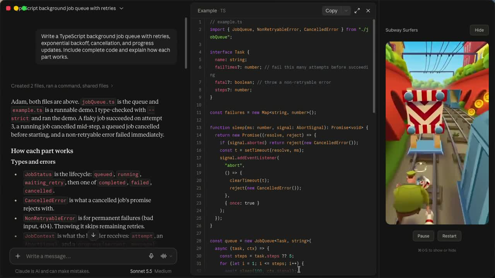

# Subway Surfers in Claude Desktop

A looping Subway Surfers video beside Claude chat, for watching while Claude works. Pause, restart, or hide the footage. This is a video pane, not a playable game.

This is an unofficial Electron patch, separate from Claude Code's native mods system. The installer patches a separate copy of Claude Desktop and leaves the original app intact.

[](https://github.com/adamholter/claude-subway-surfers/releases/download/v1.0.0/claude-subway-surfers-demo.mp4)

[Download the demo MP4](https://github.com/adamholter/claude-subway-surfers/releases/download/v1.0.0/claude-subway-surfers-demo.mp4)

## Install on macOS

You need Claude Desktop installed, Python 3, and the macOS command line signing tools.

```bash
git clone https://github.com/adamholter/claude-subway-surfers.git
cd claude-subway-surfers
bash scripts/install-desktop.sh
open "$HOME/Applications/Claude Subway.app"
```

Sign in to the separate app copy. Its name is Claude Sidecar, and it uses its own app profile. Keep the cloned source folder in place because the app loads the addon from it.

To choose another destination:

```bash
bash scripts/install-desktop.sh "$HOME/Applications/My Claude Video.app"
```

If Claude Desktop is installed elsewhere, set `CLAUDE_DESKTOP_APP` to its app path before running the installer. The installer refuses to overwrite an existing destination.

## Controls

- Pause or resume with the Pause/Play button.
- Restart the clip with Restart.
- Hide the pane with Hide.
- Press Command-Shift-S to show or hide the pane.

The clip loops automatically and has no audio.

## How it works

`desktop/subway-main.cjs` hooks Claude's Electron web contents and injects `desktop/pane.js` into the chat page. The pane plays the bundled MP4 through a blob URL. Login pages are excluded.

`scripts/patch-desktop.py` repacks the copied app's ASAR archive, updates its integrity hash, and gives the copy a separate bundle ID and helper names. The installer signs that copy locally. It does not distribute Claude's app.

The demo was recorded in Claude Desktop with Claude responding beside the video. Sign-in, advancing playback, pause, restart, and reopening the app were verified. App updates can replace the patch, and changes to Claude's UI or Electron layout can break it. macOS may ask for app or credential access when opening the signed copy.

## Native hook experiment

`hooks/register.ts` is a separate Claude Code function-hooks version. It renders precomputed video frames in a native side pane and registers `/subway`. It passed strict plugin validation and a clock test with Claude Code 2.1.287. It was not used for the recorded Desktop demo.

```bash
npm ci
npm run validate
```

The validation command requires a Claude CLI with function-hooks support. The generated API declarations in `.claude-plugin/types/` are marked early access.

## Footage

The bundled 45-second, muted clip comes from the verified Subway Surfers channel's [gameplay upload](https://www.youtube.com/watch?v=QPW3XwBoQlw), titled "Subway Surfers (2024) - Gameplay [4K 9x16] No Copyright". Source details and clip boundaries are in `assets/source.json`. Subway Surfers and its artwork belong to their respective owners.

To regenerate the native hook frames, install FFmpeg and run:

```bash
python3 scripts/prepare-frames.py assets/subway-gameplay.mp4
```

## Remove

Quit Claude Sidecar and move the separate app copy to Trash. The original Claude Desktop app remains available. The Desktop installer does not install the native hook experiment.
